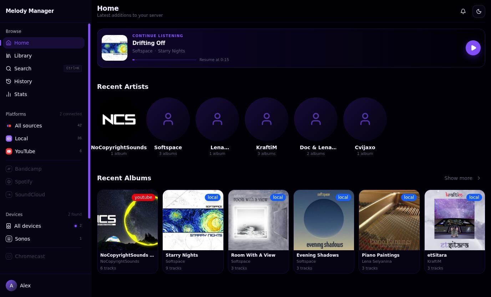
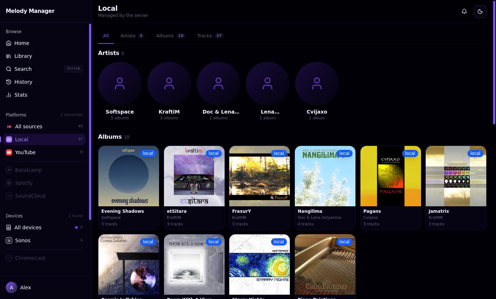
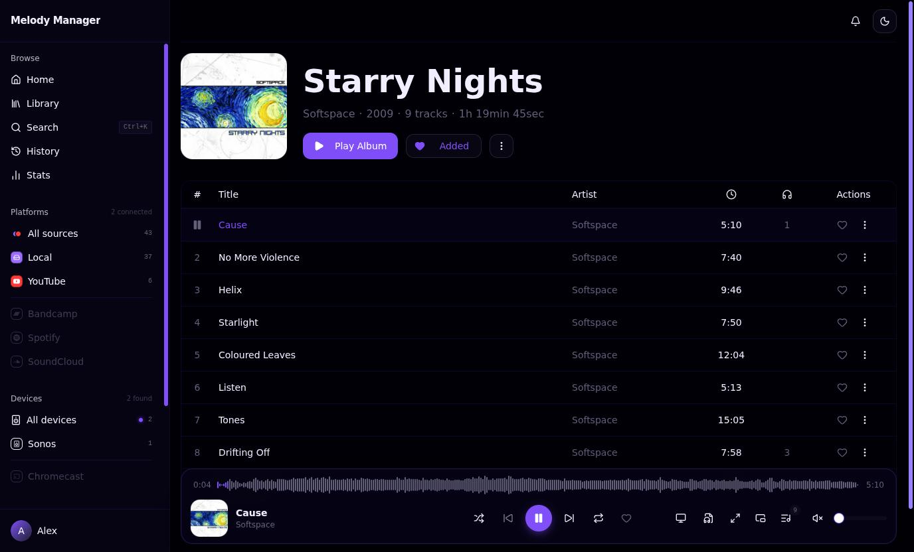
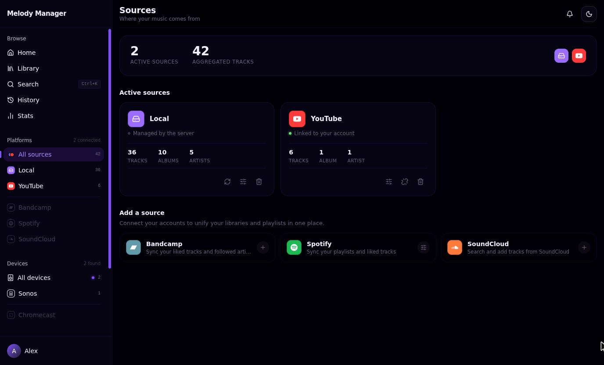
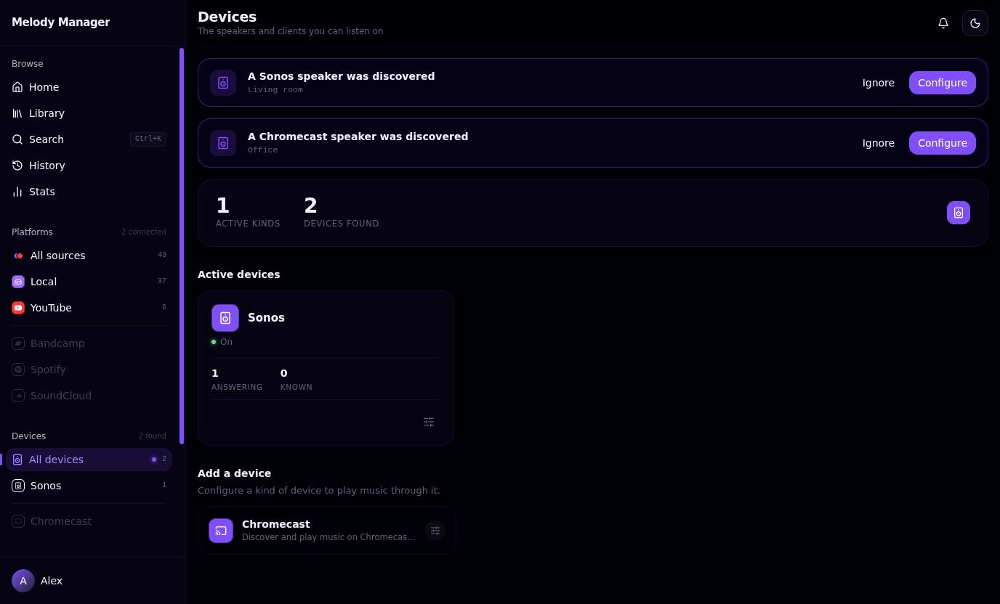

# Melody Manager

Your music, wherever it lives, in one place. Melody Manager brings together the
files on your server and what you follow on YouTube, Spotify, SoundCloud and
Bandcamp, then plays any of it in your browser or out loud on a Sonos speaker or
a Chromecast.

It runs on your own machine, in one container, and nothing about your library
leaves it.



## What it does

- **One library from several sources.** Local files are scanned and tagged from
  the folder you point at. The other sources are searched and imported alongside
  them, and a track from any of them plays the same way.
- **Plays where you are.** In the browser, in a window of its own outside the
  browser, or on a speaker on the network. Sonos and Chromecast speakers are
  discovered on their own; what a speaker cannot decode is transcoded on the way
  to it.
- **Yours to organise.** Albums, artists, playlists, likes, listening history and
  statistics, with covers resolved at import.
- **Several people, one server.** Each account has its own library, its own
  playlists and its own connections to the sources it uses.
- **English and French**, light and dark, and a progressive web app a phone can
  install from the browser. An Android build is attached to each release.

## Screenshots

| Browse a source | An album, playing |
|---|---|
|  |  |

Sources sit side by side, and a track from any of them plays the same way:



Speakers found on the network are offered as soon as they answer:



<sub>The library in these screenshots is made of releases from the Musictrade
netlabel by Softspace, KraftiM, Doc &amp; Lena Selyanina, Lena Selyanina and
Cvijaxo, published under
[CC BY](https://creativecommons.org/licenses/by/3.0/), alongside singles from
NoCopyrightSounds.</sub>

## Install

You need Docker for the server. The installer first asks which component to
install. For the server, it asks four questions and writes the two files the
answers belong in. It starts nothing by itself, so read it first if you like:

```bash
curl -fsSLO https://raw.githubusercontent.com/KevinBonnoron/melody-manager/main/install.sh &&
  bash install.sh
```

It asks where your music is, whether you want to play to speakers on your
network, which port to use, and the address those speakers will reach the server
at. That last one is the only setting people get wrong, and it is the reason a
speaker can be found and still play nothing.

Or write it yourself. Put this in `docker-compose.yml` and mount the directory
your music is in:

```yaml
services:
  melody-manager:
    image: ghcr.io/kevinbonnoron/melody-manager:latest
    container_name: melody-manager
    ports:
      - "8090:8090"
    volumes:
      - melody-manager-data:/app/pb_data
      - melody-manager-cache:/app/cache
      - ./config:/config
      # Your music, read-only. The path on the right is what you give the app.
      - /path/to/your/music:/music:ro
    restart: unless-stopped

volumes:
  melody-manager-data:
  melody-manager-cache:
```

Then:

```bash
docker compose up -d
```

Open <http://localhost:8090>. The first account you create is the administrator,
and sign-ups are closed after it unless you open them again from the settings.

Melody Manager runs on `linux/amd64` and `linux/arm64`, so a Raspberry Pi 4 or
newer will do.

The same installer can install a released client instead of the server. The
terminal player is available for Linux and macOS; the desktop client is
available for Linux on `amd64` and `arm64`:

```bash
bash install.sh --cli       # installs ~/.local/bin/melody
bash install.sh --desktop   # installs the app and its application-menu entry
```

Both default to the latest GitHub release. Use `--release vX.Y.Z` to choose a
release and `--prefix PATH` to change `~/.local`. The terminal needs `mpv` or
`ffplay`; the desktop uses the system WebKitGTK 6.0.

## First run

1. **Create your account.** The first one becomes the administrator.
2. **Point the local source at your music.** The welcome screen lists every
   source; open **Local** and give it the path inside the container, `/music` in
   the compose file above. The folder is scanned straight away, and again
   whenever a file appears in it. Each file path has at most one local track,
   including when scans overlap; upgrading removes duplicate records for the
   same path and keeps the oldest one.
3. **Connect the sources you use.** YouTube, SoundCloud and Bandcamp need
   nothing but to be switched on. Spotify needs an application of your own; the
   [configuration guide](https://kevinbonnoron.github.io/melody-manager/guide/configuration)
   says where to get the credentials.

That is enough to listen. Everything else can wait until you want it.

## Listening from a terminal

The terminal player needs Go 1.25 or newer, [Task](https://taskfile.dev/), and
either `mpv` or `ffplay` installed on the listening machine. From the repository:

```bash
task cli
```

On first launch, enter your Melody Manager server URL, account email and password.
The session is saved under `$XDG_CONFIG_HOME/melody-manager/session.json` (or
`~/.config/melody-manager/session.json`) with permissions restricted to your user.
Use `task cli -- login https://your-server` to change accounts or servers and
`task cli -- logout` to remove the saved session.

Browse albums and tracks with the arrow keys or `h`/`j`/`k`/`l`; Enter opens an album or
plays a track; selecting the current track pauses or resumes it instead of
restarting it. Use `/` to open a fresh search modal by album, artist or track
without disturbing the current screen. Right plays the selected search result
without closing the modal; Enter validates it and closes the search.
Matching albums appear before tracks; arrow keys navigate while typing, Enter
opens or plays the selection, and Esc restores the previous screen. On a selected
track, `f` toggles like and `d` toggles dislike; use `F` and `D` while typing in
the search modal so lowercase letters remain part of the query. The current
rating is shown next to the title. Album tracks follow disc and track numbers or chapter start times,
as in the web player.
The playback card shows the current album cover as coloured cells; set
`MELODY_IMAGES=none` to disable it. Press `?` at any time to open the complete
keyboard shortcuts panel, and Esc to close it. During playback, Space pauses or
resumes, `,` and `.` seek five seconds backward or forward (hold to repeat),
`n`/`p` skip once to the next/previous track when released, `s` stops, `r`
cycles repeat off/all/one and `q` quits immediately, without Enter; `s` makes
this terminal leave shared playback.
The terminal appears in the web player's device selector. Starting or resuming
from the terminal selects only that terminal, as starting in a browser does;
other devices can be added afterward from the web selector. Playback, the queue
and repeat state then remain shared instead of running an independent
terminal-only session.

MP4/M4A tracks, and tracks started away from the beginning, are downloaded to a
temporary file because seeking requires a seekable input. This can delay their
start and requires temporary disk space. The file is removed after playback.

## Playing on a speaker

A speaker fetches the audio from the server itself rather than through your
browser, so it has to be able to reach the server by an address that is not
`localhost`. Set that address once, under **Admin → Settings**, to the
one your machine has on the network (`http://192.168.1.20:8090`, say).

Sonos and Chromecast speakers are then discovered on their own and appear under
**Devices**. Discovery is multicast and multicast does not cross a router, which
includes a Docker bridge network despite the name, so either run the container
with `network_mode: host` or type the speaker's address in by hand. The
[devices guide](https://kevinbonnoron.github.io/melody-manager/guide/devices)
goes through both.

## Documentation

The full guides live at
**[kevinbonnoron.github.io/melody-manager](https://kevinbonnoron.github.io/melody-manager/)**:
installation, configuration, Docker, speakers and the HTTP API.

## Development

The repository ships a Nix dev shell with Go, Bun, Task, FFmpeg and yt-dlp. With
[direnv](https://direnv.net), `direnv allow` loads it; otherwise `nix develop`.

```bash
task dev
```

That runs the Go server on `http://localhost:8090` and the client on
`http://localhost:5173`. `task --list` has the rest: `build`, `lint`,
`type-check`, `test`, `test:e2e`, `desktop`.

The server is a single Go binary with [PocketBase](https://pocketbase.io)
embedded, serving the database, the authentication, its own `/api` endpoints and
the built [React](https://react.dev) client. The
[architecture notes](https://kevinbonnoron.github.io/melody-manager/guide/docker)
have the details.

## Licence

MIT. See [LICENSE](LICENSE).
